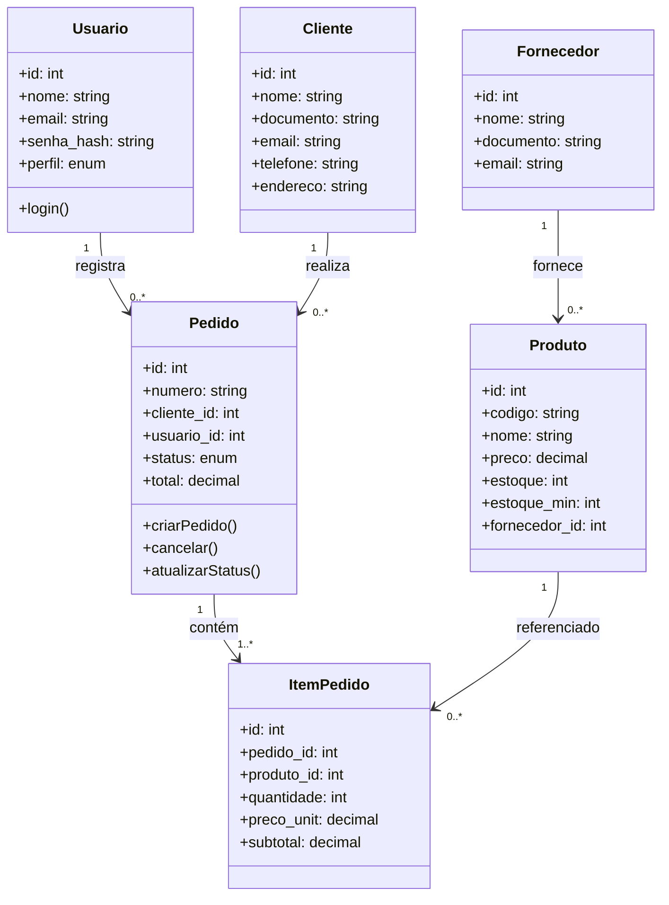
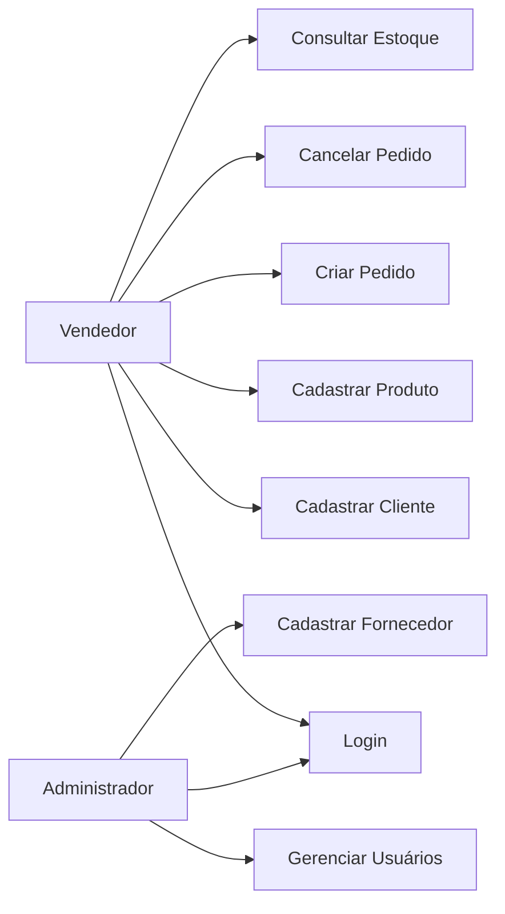
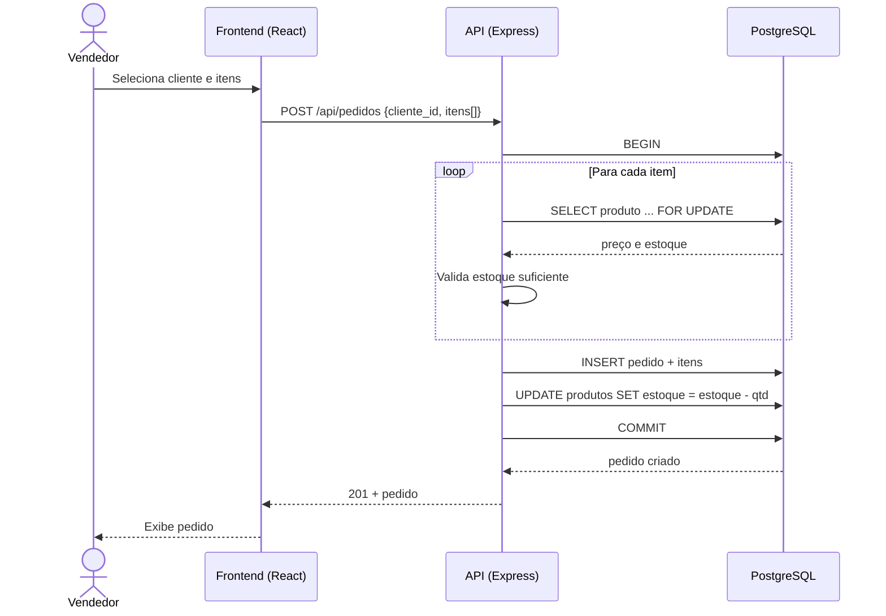
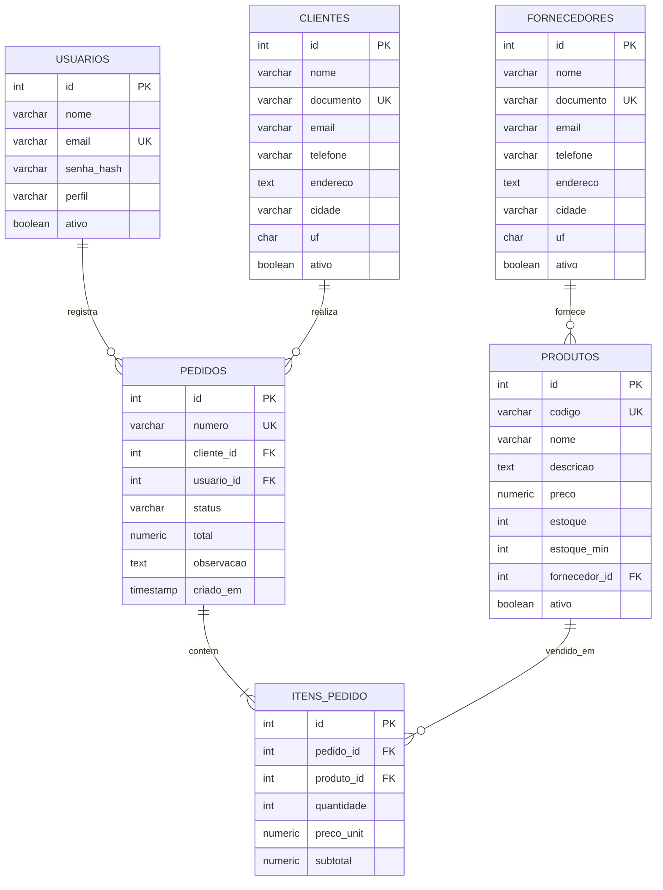

# ERP — Sistema de Gestão Empresarial

Aplicação full stack para gestão de clientes, fornecedores, estoque e pedidos/vendas.


## Stack

- **Backend:** Node.js + Express + PostgreSQL (`pg`)
- **Autenticação:** JWT + bcryptjs (perfis: `admin`, `vendedor`)
- **Frontend:** React + Vite + React Router + Axios

## Estrutura

```
projeto 6/
├── backend/          # API REST (Express)
│   ├── schema.sql    # DDL do banco + usuário admin inicial
│   ├── db.js         # Pool de conexão PostgreSQL
│   ├── middleware/   # auth (JWT) e controle de perfil admin
│   └── routes/       # auth, pedidos, CRUDs (clientes/fornecedores/produtos)
├── frontend/         # SPA React (Vite)
└── README.md
```

## Como rodar

### 1. Banco de dados

**Opção A — PostgreSQL embarcado (sem instalar nada):**

```powershell
cd backend
npm install
npm run db:local   # sobe Postgres em localhost:5432 e aplica o schema
```

**Opção B — PostgreSQL local instalado:**

```powershell
createdb -U postgres erp
psql -U postgres -d erp -f backend\schema.sql
```

Em ambos os casos, ajuste `DB_*` no `backend/.env` conforme necessário.
Isso cria as tabelas e um usuário inicial: **admin@erp.com / admin123** (troque a senha depois).

### 2. Backend

```powershell
cd backend
copy .env.example .env   # edite DB_PASSWORD com sua senha do Postgres
npm install
npm run dev              # API em http://localhost:3001
```

### 3. Frontend

```powershell
cd frontend
npm install
npm run dev              # App em http://localhost:5173 (proxy /api -> :3001)
```

## Funcionalidades

- Login com JWT; gestão de usuários (apenas admin)
- CRUD de clientes e fornecedores (com busca)
- Controle de estoque: produtos com estoque mínimo e vínculo a fornecedor
- Pedidos de venda: criação com baixa automática de estoque (transação),
  acompanhamento de status e cancelamento com devolução ao estoque
- Dashboard com totais (clientes, produtos, pedidos abertos, valor em vendas)

## API (resumo)

| Método | Rota | Descrição |
|---|---|---|
| POST | `/api/auth/login` | Login (retorna JWT) |
| GET/POST | `/api/auth/usuarios` | Listar/criar usuários (admin) |
| GET/POST/PUT/DELETE | `/api/clientes`, `/api/fornecedores`, `/api/produtos` | CRUDs (`?q=` busca) |
| GET/POST | `/api/pedidos` | Listar/criar pedidos |
| GET | `/api/pedidos/:id` | Detalhe do pedido com itens |
| PATCH | `/api/pedidos/:id/status` | Atualizar status |
| POST | `/api/pedidos/:id/cancelar` | Cancelar e estornar estoque |
| GET | `/api/dashboard` | Métricas gerais |

---

## Requisitos e Diagramas UML

### Requisitos funcionais

- RF01 — Autenticação de usuários com perfis (admin/vendedor)
- RF02 — Cadastro, consulta, edição e exclusão de clientes
- RF03 — Cadastro, consulta, edição e exclusão de fornecedores
- RF04 — Cadastro de produtos com preço, estoque e fornecedor
- RF05 — Alerta de produtos com estoque abaixo do mínimo
- RF06 — Criação de pedidos de venda com múltiplos itens
- RF07 — Baixa automática de estoque na confirmação do pedido
- RF08 — Estorno de estoque no cancelamento do pedido
- RF09 — Acompanhamento de status do pedido (pendente → entregue/cancelado)
- RF10 — Dashboard com indicadores de vendas e cadastros

### Diagrama de Classes (UML)



### Diagrama de Casos de Uso



### Diagrama de Sequência — Criar Pedido



### Diagrama de Entidade-Relacionamento (DER)


